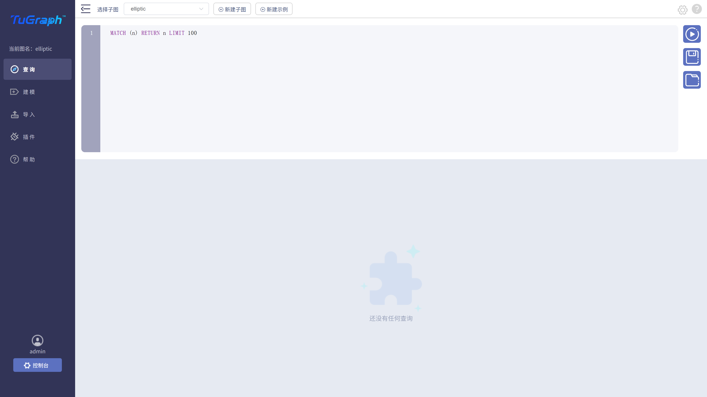
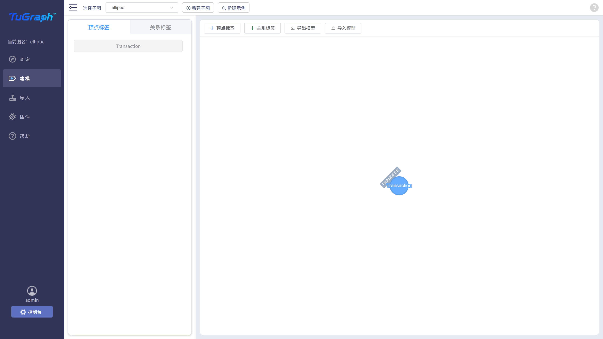
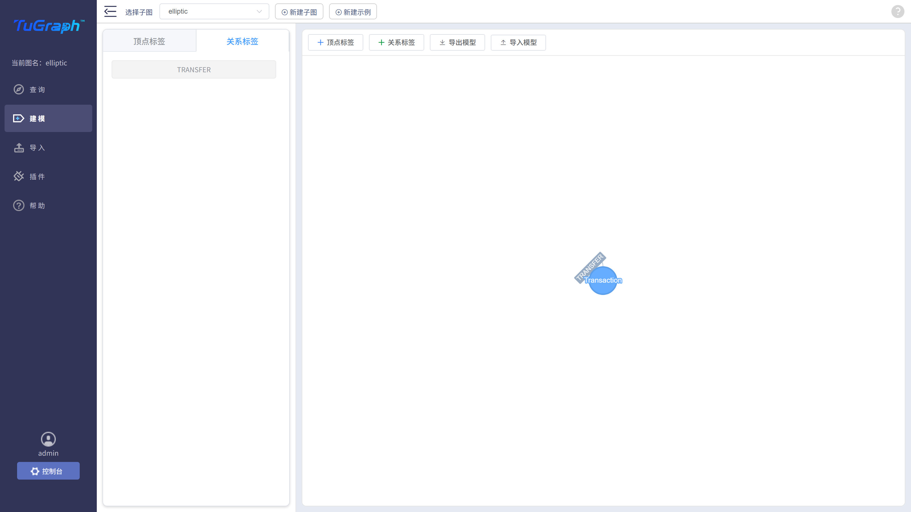
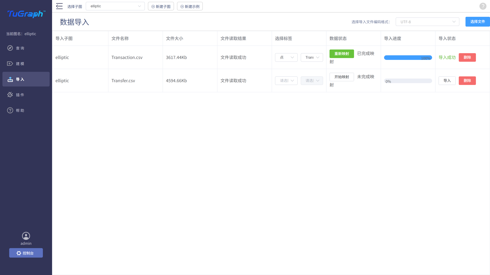
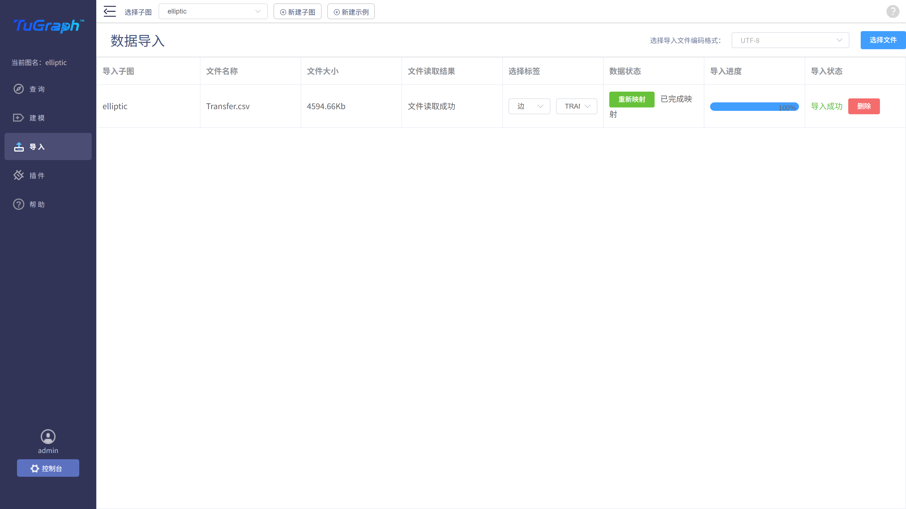
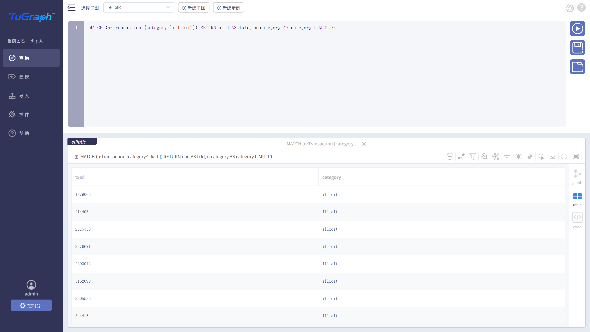
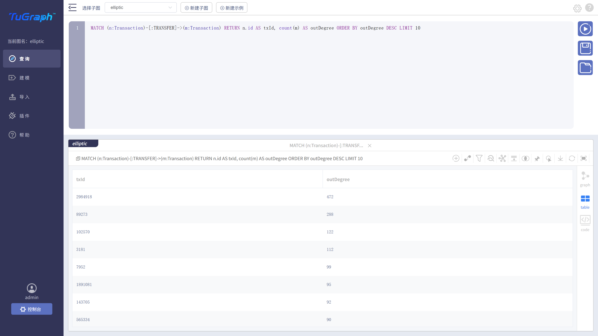

# 图数据库 TuGraph 基本操作

> 姓名：石子墨　学号：2025312613　班级：中金发25-2

> 环境：Windows 11 家庭版 / WSL 3.0.5 / Docker 29.9.3 / TuGraph 4.3.1
> 数据：Elliptic++ Transactions，203,769 个交易顶点、234,355 条转账关系

## 一、基础知识介绍

### （一）图数据库

图数据库用顶点（Vertex / Node）、边（Edge / Relationship）和属性（Property）三种元素来表达事物及其关联关系。顶点对应实体，边对应实体之间的关系，属性以键值对的形式挂在顶点或边上。

和关系数据库相比，图数据库把"关系"提到了存储层。关系库里查两跳以上的关联，要写多层自连接，中间结果随跳数膨胀；图数据库里关系是直接存下来的，遍历就是顺着指针走，代价和跳数线性相关。反洗钱、社交网络、知识图谱这类"关系比数据本身更要紧"的场景，用图更合适。

| 组成 | 英文 | 说明 |
| --- | --- | --- |
| 顶点 | Vertex / Node | 实体，比如一笔交易、一个人 |
| 边 | Edge / Relationship | 实体之间的有向关联，比如"A 转账给 B" |
| 属性 | Property | 挂在顶点或边上的键值对，比如交易类别 |

属性图模型（Property Graph Model）是 Neo4j、TuGraph、NebulaGraph 等图数据库共同遵循的模型。一种顶点标签大致相当于关系库里的一张点表，一种边类型相当于一张边表，区别在于图数据库不要求外键，也不需要 JOIN。

### （二）TuGraph

TuGraph 由蚂蚁集团与清华大学联合研发，提供高性能的 OLTP / OLAP 双引擎、内置图算法库，以及兼容 OpenCypher 的查询接口，在国际图数据库基准测试中多次取得性能第一。

它的核心服务程序 `lgraph_server` 在单节点模式下同时开放三个端口：7070 提供 REST API 与 Web 管理界面，7687 提供 Bolt 协议供 Neo4j 兼容客户端连接，9090 提供 RPC 服务与 Prometheus 监控接入。配套工具方面，离线批量导入用 `lgraph_import`，Web 端则提供了可视化的建模与导入界面。

本实验用到的能力主要是三块：Web 控制台完成建库、建模、导数据；Cypher 完成查询与增删改；7070 端口背后的 REST 接口用来做结果校验。

### （三）Cypher 查询语言

Cypher 是一种声明式图查询语言，关键字不区分大小写，核心表达力是模式匹配。节点写作 `(变量名:标签 {属性})`，关系写作 `-[变量名:关系类型]->`，路径写作 `(a)-[r]->(b)`。

基本范式是 `MATCH` 加 `RETURN`，作用相当于关系库的 `SELECT`。增删改由四类语句承担：`CREATE` 建顶点和关系，`SET` 改属性，`DELETE` 和 `REMOVE` 删元素，`MATCH` 配合 `WHERE` 做检索。复杂查询则依靠路径模式 `(a)-[*..n]->(b)`、`WITH` 传递中间结果、`count` / `sum` / `avg` 等聚合函数，以及 `ORDER BY`、`LIMIT` 组合完成。

有一点和 SQL 差别比较大：Cypher 没有显式的 `GROUP BY`，分组是由聚合函数隐式触发的。

### （四）数据集准备

本次作业使用 Elliptic++ Transactions 数据集，由比特币交易历史脱敏抽样而成，是区块链反洗钱与可疑交易识别研究里最常用的公开图数据之一。数据集由两个 CSV 文件构成：

| 文件 | 内容 | 行数（不含表头） |
| --- | --- | --- |
| `elliptic_txs_classes.csv` | 交易编号与类别标签 | 203,769 |
| `elliptic_txs_edgelist.csv` | 引用方交易编号与被引用方交易编号 | 234,355 |

类别标签有三种取值，分布很不平衡：

| 原始值 | 含义 | 数量 | 占比 |
| --- | --- | --- | --- |
| `1` | illicit，非法（勒索、洗钱、暗网交易等） | 4,545 | 2.23% |
| `2` | licit，合法（交易所、矿池等） | 42,019 | 20.62% |
| `unknown` | 未标注 | 157,205 | 77.15% |

正式建图之前，先用 pandas 对两个文件做了一次质量核查，主要确认三件事：有无重复 ID 和重复边、有无自环、边表端点能否在类别表中找到。结果是 203,769 个交易编号无重复，234,355 条边无重复也无自环，边表出现的端点与类别表中的节点完全对应，既没有悬空边也没有孤立点。节点平均度数 2.30，度数最大的是交易 `2984918`，共 473 条边。

这组统计后面会用来核对导入是否完整。

## 二、启动 TuGraph 平台

### （一）运行环境

本次作业在 Windows 11 家庭版上完成。该版本没有 Hyper-V，因此 TuGraph 只能通过 Docker Desktop 的 WSL2 后端运行。实验开始前，宿主机既未安装 WSL2 也未安装 Docker，需从零配置。

最终环境为：WSL 3.0.5.0（内核 6.18.58.1-1）、Docker 29.9.3、TuGraph 4.3.1，浏览器使用 Microsoft Edge。

需要说明一处与实验指导书的差异。指导书给出的镜像标签是 `tugraph/tugraph-runtime-ubuntu18.04:4.5.0`，但 Docker Hub 上该仓库实际只发布到 `4.3.1`，4.5.x 仅有 rpm 和 deb 安装包，没有制作镜像。因此本次实验使用 `4.3.1`。指导书中"不要直接复制粘贴，先看镜像列表里拉下来的版本"一句，对应的正是这种情况。

### （二）启动步骤

启动分为四步，全部在管理员 PowerShell 中执行。

第一步，启用 WSL2 所需的两个 Windows 功能。家庭版没有 Hyper-V，必须先打开"虚拟机平台"和"Linux 子系统"，重启后再安装 WSL 运行时。

```powershell
dism.exe /online /enable-feature /featurename:VirtualMachinePlatform /all /norestart
dism.exe /online /enable-feature /featurename:Microsoft-Windows-Subsystem-Linux /all /norestart
```

WSL 运行时最初尝试用 `wsl --install` 安装，该命令需要从微软商店下载安装包，等待半个多小时仍未完成。改为直接下载 MSI 本地安装后，不到一分钟即完成：

```powershell
msiexec /i D:\tugraph_data\downloads\wsl.msi /qn /norestart
```

重启后用 `wsl --version` 确认，版本号为 3.0.5.0、默认版本为 2 即安装成功。

第二步，安装 Docker Desktop 并指定 WSL2 后端。

```powershell
DockerDesktopInstaller.exe install --quiet --accept-license --backend=wsl-2
net localgroup docker-users "$env:USERDOMAIN\$env:USERNAME" /add
```

第二条命令将当前用户加入 docker-users 组，否则后续执行 docker 命令会提示权限不足。由于 Windows 只在登录时读取组成员身份，加组后必须注销重新登录才能生效。重新登录并启动 Docker Desktop，左下角显示 Engine running 后，用 `docker version` 确认客户端与服务端版本均为 29.9.3。

第三步，拉取 TuGraph 运行时镜像。

```powershell
docker pull tugraph/tugraph-runtime-ubuntu18.04:4.3.1
```

镜像压缩后约 4.9 GB，解压后接近 18 GB。国内直连 Docker Hub 的速度只有 0.1 MB/s 左右，需配置镜像加速或使用代理，本机在代理环境下实测可达 5 至 14 MB/s。

第四步，以后台模式启动容器，并将容器内的三个端口映射到宿主机。

```powershell
docker run -d --name tugraph `
  -v D:\tugraph_data:/mnt `
  -p 7070:7070 -p 7687:7687 -p 9090:9090 `
  tugraph/tugraph-runtime-ubuntu18.04:4.3.1 `
  lgraph_server -d run --enable_plugin true
```

各参数含义如下：

| 参数 | 作用 |
| --- | --- |
| `-d` | 容器在后台运行，不占用当前终端 |
| `-v D:\tugraph_data:/mnt` | 将宿主机目录挂载到容器 `/mnt`，数据持久化，删除容器不丢数据 |
| `-p 7070:7070` | Web 管理界面与 REST API |
| `-p 7687:7687` | Bolt 协议，供客户端驱动连接 |
| `-p 9090:9090` | RPC 服务与监控 |
| `lgraph_server -d run --enable_plugin true` | 以服务模式启动 TuGraph，并启用 C++ / Python 插件 |

执行 `docker ps` 确认容器状态为 Up 且三个端口均已映射，即启动完成。

### （三）系统登录

浏览器访问 <http://localhost:7070>，进入 TuGraph DB Browser 登录界面。


图 1　TuGraph DB Browser 登录界面

使用默认账号登录，用户名 `admin`，密码 `73@TuGraph`。首次登录时系统会强制跳转至修改密码界面，并弹出"为了您的数据安全，请修改 admin 的初始密码"的提示。为与实验指导书保持一致，本次保留了默认密码，直接进入工作台，该提示数秒后自动消失。生产环境中这一步应当修改。

登录后进入 Cypher 工作台，左侧导航栏依次为查询、建模、导入、插件、帮助，右上角可切换子图。



图 2　系统登录成功，进入 Cypher 工作台

## 三、图建模与数据导入

### （一）图建模设计

依据两个 CSV 的字段结构，设计如下属性图模型。

| 类型 | 标签 | 属性与约束 |
| --- | --- | --- |
| 顶点 | `Transaction` | `id`，INT64，主键、唯一、建索引；`category`，STRING，可空 |
| 边 | `TRANSFER` | 无属性；起点与终点标签约束均为 `Transaction` |

Elliptic 数据能提供的信息只有两类：交易本身的编号与类别，以及"交易 A 流向交易 B"的方向关系。因此模型只需要一种顶点、一种边。

建模时做了两处调整。一是把原始字段名 `class` 改为 `category`，因为 `class` 在 Cypher 中容易与关键字混淆，改名可以避免解析歧义。二是把原始取值 `1`、`2`、`unknown` 映射为 `illicit`、`licit`、`unknown`，这样查询中直接写 `{category:'illicit'}` 即可，比写 `{class:'1'}` 更直观。

主键 `id` 采用 INT64 而不是 STRING，因为交易编号本身是整数，用整数类型既省空间，比较也更快。

在左侧"建模"页进入顶点标签页，点击"顶点标签"逐个添加属性：`id` 的选填为"否"、索引和唯一均为"是"，`category` 的选填为"是"、索引和唯一均为"否"，主键选择 `id`。



图 3　顶点标签 Transaction 创建完成

随后在"关系标签"页添加边类型，名称填 `TRANSFER`，起始标签处点击"添加"，起点与终点均选择 `Transaction`，属性留空。



图 4　边标签 TRANSFER 创建完成

建模完成后可通过接口核对模型是否落库：

```bash
curl -H "Authorization: Bearer <token>" http://localhost:7070/db/elliptic/label
# {"edge":["TRANSFER"],"vertex":["Transaction"]}
```

### （二）数据导入步骤

原始 CSV 不能直接导入，需先整理成 TuGraph 认可的格式：点表首列为顶点 ID，边表前两列为起点和终点，均带一行表头。

```python
import pandas as pd

cls = pd.read_csv("elliptic_txs_classes.csv")
edge = pd.read_csv("elliptic_txs_edgelist.csv")

MAP = {"1": "illicit", "2": "licit", "unknown": "unknown"}

pd.DataFrame({
    "id": cls["txId"].astype("int64"),
    "category": cls["class"].map(MAP).fillna("unknown"),
}).to_csv("import/Transaction.csv", index=False, encoding="utf-8")

pd.DataFrame({
    "src": edge["txId1"].astype("int64"),
    "dst": edge["txId2"].astype("int64"),
}).to_csv("import/Transfer.csv", index=False, encoding="utf-8")
```

得到 `Transaction.csv`（3.6 MB）与 `Transfer.csv`（4.6 MB）两个文件。

导入通过 Web 端可视化界面完成。进入"导入"页，点击右上角"选择文件"，将两个 CSV 一次选中，编码保持 UTF-8。上传完成后，每行会显示"文件读取成功"。

接下来配置映射关系。第一列选择数据属于"点"还是"边"，第二列选择具体标签：点表选"点"加 `Transaction`，边表选"边"加 `TRANSFER`。点击"开始映射"后，页面下方展开数据预览，需要设置三处：起始行填 1 以跳过表头；每个 CSV 列对应一个属性下拉，`id` 列对 `id`、`category` 列对 `category`；边表的两列分别指向 `Transaction` 作为起点与终点。

设置完成后点击"映射"，该行状态变为"已完成映射"；再点击行末"导入"，进度条走到 100% 且状态变为"导入成功"即完成。

顶点表先导入，共 203,769 行：



图 5　顶点表导入完成，203,769 行

边表随后导入，共 234,355 行：



图 6　边表导入完成，234,355 行

需要留意的是，上传的文件列表只保存在前端内存中，刷新页面即丢失，因此上传、映射、导入三个动作必须在同一次会话内完成。

### （三）导入结果核对

界面提示"导入成功"只说明流程执行完毕，不代表数据正确，仍需回到库中统计核对。

```cypher
MATCH (n:Transaction) RETURN count(n) AS c
-- 203769

MATCH ()-[r:TRANSFER]->() RETURN count(r) AS c
-- 234355

MATCH (n:Transaction) RETURN n.category AS category, count(n) AS total ORDER BY total DESC
-- unknown 157205 / licit 42019 / illicit 4545
```

三项结果与导入前 pandas 的统计完全一致，说明顶点无丢失、边无遗漏、属性无串列。

## 四、Cypher 查询示例

Cypher 的完整增删改查范式由 `CREATE`、`SET`、`DELETE` 与 `REMOVE`、`MATCH` 配合 `WHERE` 四类语句构成，其中 `MATCH` 最为常用。本节针对已导入的 Elliptic 数据集，自行设计基础查询与复杂查询各一例，并补充增删改操作的验证过程。

### （一）基础查询与增删改

业务问题：如何从 203,769 笔交易中筛选出被标记为非法的交易，并验证 Cypher 是否支持数据的增删改。

```cypher
MATCH (n:Transaction {category:'illicit'})
RETURN n.id AS txId, n.category AS category
LIMIT 10
```



图 7　基础查询执行结果

语句要点：圆括号表示顶点，`n` 为变量名，`Transaction` 为标签；花括号中的 `{category:'illicit'}` 是属性条件，等价于再写一个 `WHERE n.category = 'illicit'`；`RETURN ... AS ...` 为结果列起别名；`LIMIT 10` 限制返回条数，避免一次渲染过多顶点导致页面卡顿。

结果分析：返回 10 条非法交易，编号从 1879066 起。该查询命中标签与属性索引，耗时约 1 毫秒。

增删改操作在同一个子图内验证，完成后删除测试数据，不影响已导入的 203,769 个顶点：

```cypher
-- 增
CREATE (n:Transaction {id:999999999, category:'test'})
RETURN n.id, n.category

-- 改
MATCH (n:Transaction {id:999999999})
SET n.category = 'licit'
RETURN n.id, n.category

-- 删
MATCH (n:Transaction) WHERE n.id = 999999999 DELETE n
-- deleted 1 vertices, deleted 0 edges.
```

`DELETE` 用于删除顶点与边；若只想移除某个属性，应使用 `REMOVE`，例如 `REMOVE n.category`。删除仍有关联边的顶点时，必须将关系一并删除，写作 `MATCH (n)-[r]-() DELETE n, r`，否则会因顶点仍存在关联边而报错。

写操作完成后再统计一次顶点数，结果仍为 203,769，说明子图已恢复原状。

### （二）复杂查询

业务问题：洗钱网络中资金往往先归集到少数中枢交易再向外分散，如何找出这些资金转出最频繁的交易。

```cypher
MATCH (n:Transaction)-[:TRANSFER]->(m:Transaction)
RETURN n.id AS txId, count(m) AS outDegree
ORDER BY outDegree DESC
LIMIT 10
```



图 8　复杂查询执行结果

语句要点：`-[:TRANSFER]->` 表示沿 `TRANSFER` 关系按箭头方向遍历，中括号内为关系类型；`count(m)` 为聚合函数，Cypher 中没有显式的 `GROUP BY`，只要出现聚合函数，未被聚合的字段（此处为 `n.id`）即自动成为分组键；`ORDER BY ... DESC` 按聚合结果降序排列。

结果分析：出度前五名如下。

| 排名 | 交易编号 | 出度 |
| --- | --- | --- |
| 1 | 2984918 | 472 |
| 2 | 89273 | 288 |
| 3 | 102570 | 122 |
| 4 | 3181 | 112 |
| 5 | 7952 | 99 |

排名第一的交易 `2984918` 转出 472 笔，加上其 1 条入边，恰好等于前述离线统计中的最大度数 473，说明路径匹配无遗漏。

若关注非法资金的最终去向，可将来源类别与去向类别做交叉统计：

```cypher
MATCH (a:Transaction)-[r:TRANSFER]->(b:Transaction)
RETURN a.category AS src, b.category AS dst, count(r) AS cnt
ORDER BY cnt DESC
```

| 来源类别 | 去向类别 | 笔数 |
| --- | --- | --- |
| unknown | unknown | 131,778 |
| unknown | licit | 45,386 |
| licit | licit | 33,930 |
| licit | unknown | 15,116 |
| unknown | illicit | 3,993 |
| illicit | unknown | 1,458 |
| illicit | illicit | 998 |
| illicit | licit | 915 |
| licit | illicit | 781 |

九类之和为 234,355，与边总数一致，可视为又一次完整性校验。从业务角度看，`illicit → licit` 的 915 笔最值得关注：非法资金正试图流入交易所、矿池等合法主体完成洗白。

此外，路径查询可用于发现"非法 → 中转 → 非法"的资金链条：

```cypher
MATCH p=(a:Transaction {category:'illicit'})-[:TRANSFER*2]->(c:Transaction {category:'illicit'})
RETURN a.id AS fromId, c.id AS toId
LIMIT 5
```

`*2` 表示固定两跳。同样的需求在关系库中需要两次自连接，在图数据库中仅需一行。

## 五、实验总结

本次实验完成了从环境搭建、数据建模、批量导入到 Cypher 查询的完整流程，最终将 203,769 个顶点与 234,355 条边全量导入 TuGraph，并通过多项统计与原始数据完成对账。

建模环节的体会是，模型简单不代表选择简单。Elliptic 数据可用于建模的字段只有两列，模型必然是一类顶点一类边，但主键类型、索引设置、枚举值是否需要语义化，都会影响后续查询的书写体验。将 `class` 改为 `category`、将 `1` 映射为 `illicit`，改动量很小，查询语句的可读性却明显提升。

导入环节的体会是，"导入成功"这一提示不足以作为数据正确的依据。界面提示只说明流程执行完毕，真正的验证必须回到库中统计顶点数、边数、类别分布，与导入前的离线结果逐项比对。本次三项统计完全一致，交叉统计的九类流向之和也等于边总数，才可确认数据完整。

查询环节的体会是，Cypher 的表达方式与 SQL 差异较大。写 SQL 时思考的是表之间如何连接，写 Cypher 时思考的是图的形态，再把业务问题翻译成路径模式。资金流向这一关系直接表示为 `(a)-[:TRANSFER]->(b)`，接近自然语言的描述。反过来，隐式分组这一特性在初学时容易造成困惑，需要专门适应。

最后，多跳查询的性能差异较为明显。两跳、三跳查询在这张二十万顶点的图上均为毫秒级返回，而同等需求在关系库中仅书写自连接就需要相当篇幅。这也解释了图数据库在资金链路追踪类场景中被广泛采用的原因。
